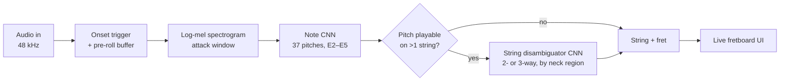
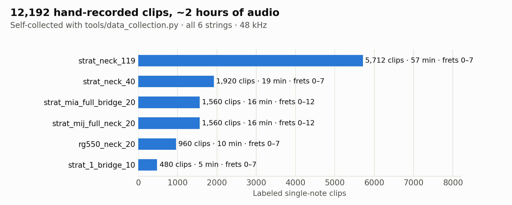
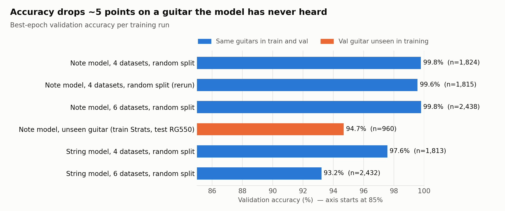
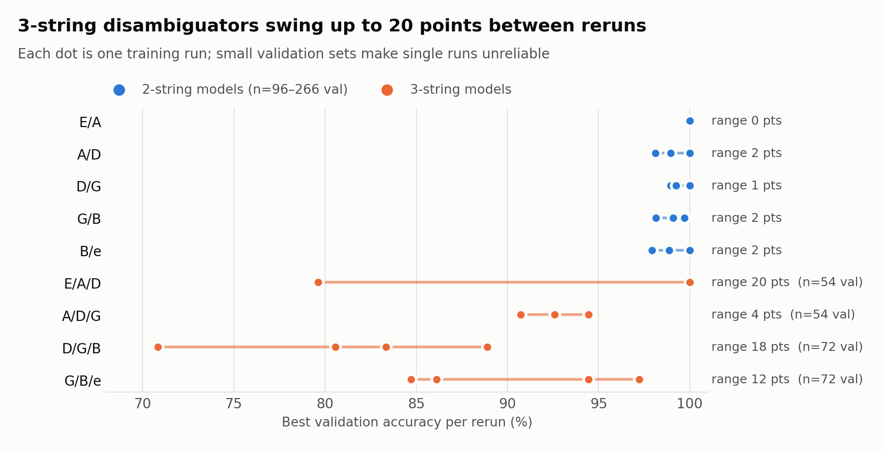

# fretListener

**Real-time guitar note *and fret* recognition from audio.** Play a note; fretListener tells you the pitch, the string, and the fret, live.

Knowing the pitch isn't enough to place a note on the neck: the same E4 can be played in up to three places. fretListener uses a tiered set of small CNNs. A note model identifies the pitch, then a string disambiguator picks between the possible positions by listening to timbre.

Everything is built from scratch: a custom data-collection tool, a self-recorded dataset, the training pipeline, and two realtime GUI apps (a live fretboard listener and a practice trainer).

## Highlights

- **12,192 hand-recorded, labeled single-note clips** (~2 hours across 6 guitar/pickup datasets), captured with a purpose-built recording tool
- **99.8% note accuracy** on held-out clips from the training guitars, and **94.7% on a guitar the model never heard** (the honest number; see [Findings](#findings))
- **Tiered inference:** pitch first, then a per-region string disambiguator only when the pitch is ambiguous
- **Realtime on a Mac:** onset-triggered capture, a sliding-window confidence sweep, and a Tkinter fretboard UI
- **Reproducible runs:** every training run writes its command, environment, hyperparameters, curves and per-class accuracy to `artifacts/models/`

## How it works



| Model | Task | Input | Notes |
|---|---|---|---|
| `NoteCNN` (`src/note_model.py`) | Pitch class (MIDI) | log-mel, attack window | 3 conv blocks + global average pooling |
| `StringCNN` (`src/string_model.py`) | Which of 6 strings | log-mel | Experimental direct approach |
| `TripletDisambiguatorCNN` (`src/disambiguator_model.py`) | Which of 3 candidate strings | log-mel | One model per string region (E/A/D, A/D/G, D/G/B, G/B/e) |

Key design choices:

- **Shared preprocessing:** training and live inference compute spectrograms with the same code in `common/`, to avoid train/serve drift.
- **Attack-focused windows:** models see a 250 ms window around the pick attack (live inference sweeps nearby offsets and keeps the most confident).
- **Provenance-aware splits:** clips from the same source recording never land on both sides of the train/validation split.

## Data

<picture>
  <source media="(prefers-color-scheme: dark)" srcset="docs/figures/dataset_dark.png">
  
</picture>

All audio was recorded by the author with `tools/data_collection.py`. The tool prompts for a string and fret, records continuous takes, detects onsets, and slices them into labeled clips with metadata. Each dataset is named `<guitar>_<pickup>_<takes per position>`.

**The recordings are not included in this repo.** The code expects datasets in this layout:

```
data/<dataset_name>/
├── audio/s{string}_f{fret}_t{take}_{session}.wav   # string 1 = high E
└── meta/metadata.csv                               # string, fret, midi, take, sample_rate, ...
```

Summary statistics are in [`docs/results/datasets.json`](docs/results/datasets.json).

## Findings

### 1. In-distribution accuracy overstates real-world performance

<picture>
  <source media="(prefers-color-scheme: dark)" srcset="docs/figures/generalization_dark.png">
  
</picture>

- With random train/validation splits, the note model reaches 99.6–99.8%.
- Training only on Stratocaster recordings and validating on an Ibanez RG550 drops it to **94.7%**.
- A random split can't show this gap, because the same guitar is on both sides of the split.
- The string model got *harder* as datasets were added (97.6% to 93.2%): more guitars means more timbre variety for the same label.

### 2. Two-string disambiguation is easy; three-string disambiguation needs more data

<picture>
  <source media="(prefers-color-scheme: dark)" srcset="docs/figures/disambiguators_dark.png">
  
</picture>

- Pairwise models (e.g. A string 5th fret vs open D) are consistently 98–100%.
- The 3-way models cover more of the neck, but they were trained on only 300–400 clips with 54–72 validation clips each. Identical reruns vary by up to 20 points, so a single run's number is unreliable.
- **The bottleneck is data, not architecture.**

The full development story is in **[docs/DEVLOG.md](docs/DEVLOG.md)**.

## Repository layout

```
common/      shared audio preprocessing, guitar theory, dataset utilities
src/         models, training scripts, realtime apps (fretListener.py, fretTrainer.py)
tools/       data collection, training-mix builders, offline inference, training GUI
recipes/     training-mix CSVs (file lists and labels; audio not included)
artifacts/   per-run training summaries and plots (model weights not included)
docs/        dev log, figures, and the script that regenerates them
```

## Quickstart

```bash
pip install -r requirements.txt

# 1. Record a dataset (GUI)
python tools/data_collection.py

# 2. Build a training mix
python tools/build_training_mix.py --mode note --datasets data/my_guitar --output recipes/note_mix.csv

# 3. Train the note model (writes to artifacts/models/note_<timestamp>/)
python src/train_note_model.py --mix-csv recipes/note_mix.csv --epochs 30

# 4. Build mixes for and train the string disambiguators
python tools/build_disambig_mix.py --all-triplets --datasets data/my_guitar --output-dir recipes/disambig/
python src/train_disambiguator.py --batch --type triplet --mix-dir recipes/disambig/

# 5. Run the live listener (pick checkpoints in the GUI)
python src/fretListener.py
```

You can also do steps 2–4 in one place with `python tools/train_gui.py`. `python src/fretTrainer.py` opens a scale and arpeggio practice tool that checks what you play in real time.

Regenerate the figures with `python docs/make_figures.py`.

## Limitations and next steps

- **No separate test set:** reported numbers are best-epoch *validation* accuracy, and validation also drives checkpoint selection. Next: a fixed held-out test set and leave-one-guitar-out evaluation for every model.
- **Coverage:** clean tone, single notes, frets 0–12, standard tuning. No chords, bends or distortion yet.
- **3-string disambiguators** need roughly 10× more clips per region before their numbers are stable.

## License

Code is released under the [MIT License](LICENSE). The recorded dataset and trained weights are not distributed.
